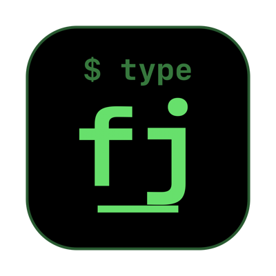
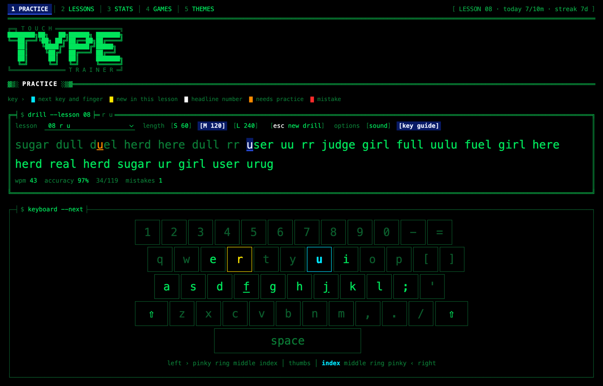
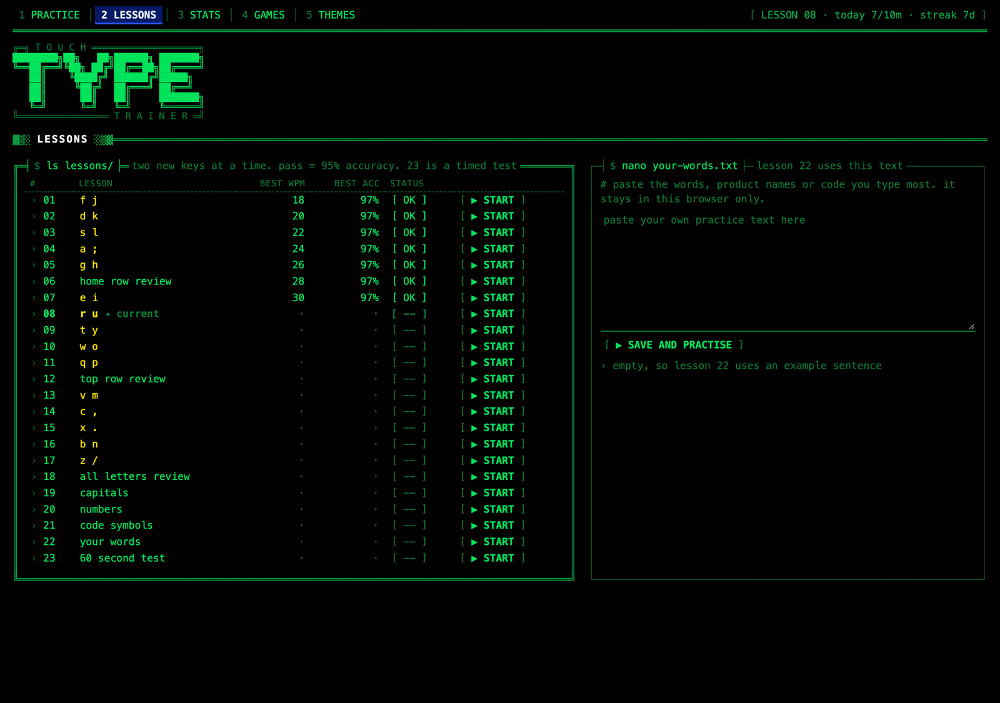
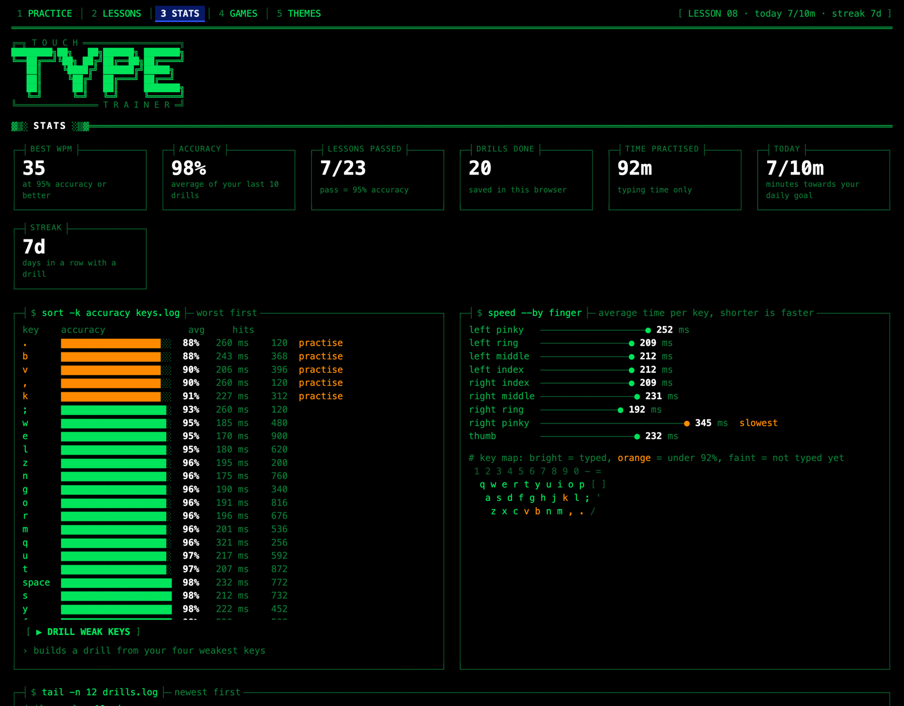
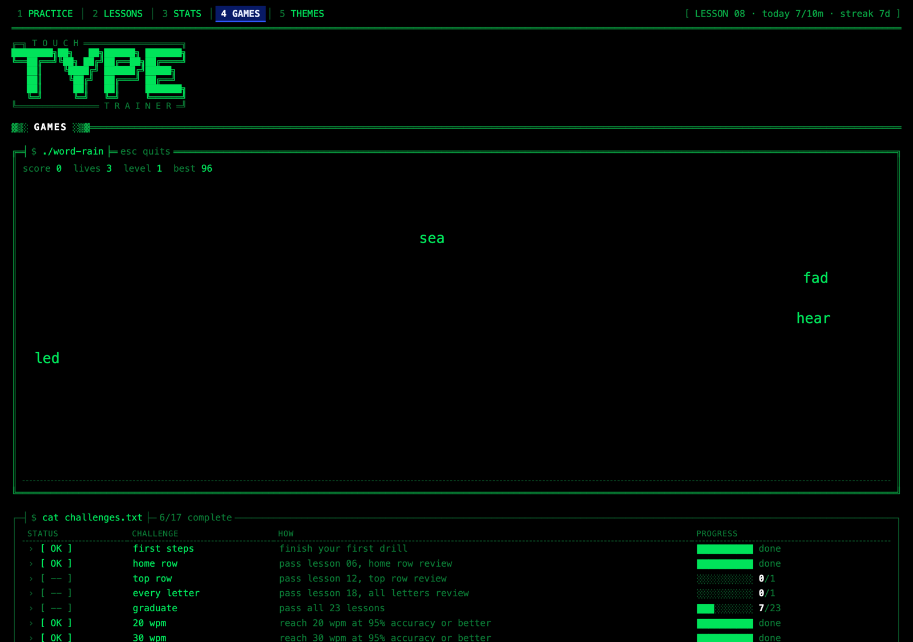
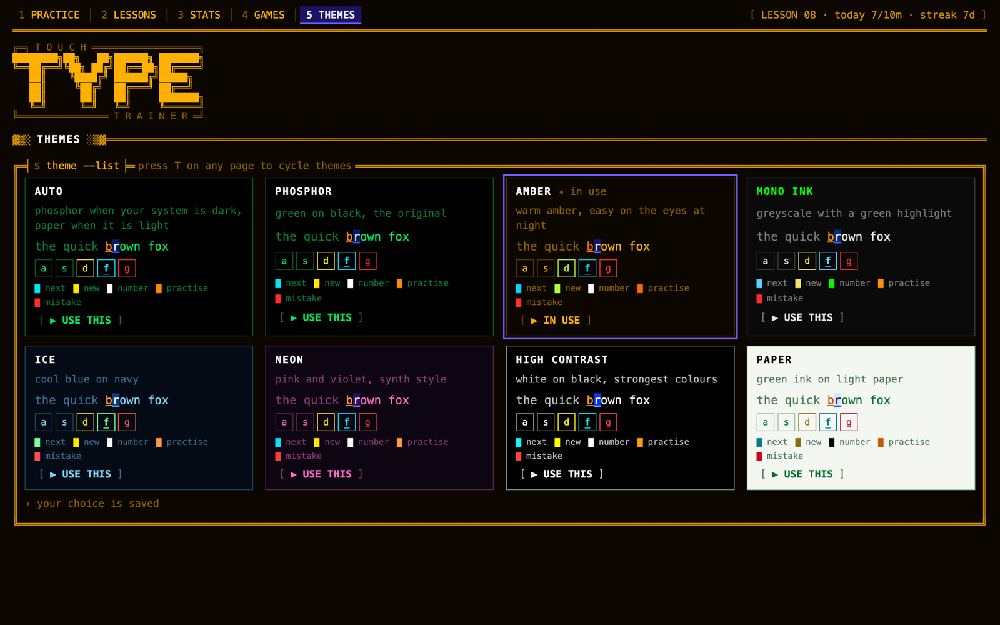

<div align="center">
  
  <h1>Touch Type Trainer</h1>
  <p><b>Learn to touch type, two keys at a time, in a terminal-style trainer.</b></p>

[](https://github.com/ajd1776/touch-type-trainer/releases/latest)
[](https://ajd1776.github.io/touch-type-trainer/)

[](LICENSE)

</div>

<p align="center">
  
</p>

Touch Type Trainer teaches touch typing with short drills that add two new keys per lesson. It shows the next key and the finger to press it with, tracks your speed and accuracy per key, and builds extra drills from your weakest keys. It runs as a native Mac app or in any browser, with no account and no internet connection.

## Install

**In your browser:** open **[the web version](https://ajd1776.github.io/touch-type-trainer/)**. Nothing to install.

**On a Mac:** **[download the latest version](https://github.com/ajd1776/touch-type-trainer/releases/latest)**, unzip it and drag **Touch Type Trainer** into Applications. It runs on Apple silicon and Intel Macs with macOS 12 or later.

> [!NOTE]
> The app isn't signed with an Apple developer ID, so macOS blocks it the first time. Open it once, then go to **System Settings › Privacy & Security** and click **Open Anyway**. On macOS 14 and earlier you can instead right-click the app and choose **Open**.

## Features

- **23 lessons.** Home row first, then the top and bottom rows, capitals, numbers, code symbols, your own text and a 60 second test.
- **Key guide.** A large on-screen keyboard highlights the next key, the new keys in the lesson and the finger to use.
- **Accuracy first.** A wrong key doesn't move you on, and a lesson passes at 95% accuracy.
- **Weak key drills.** One click builds a drill from the four keys you miss or hesitate on most.
- **Your own words.** Paste product names, code or anything you type often, and practise on it.
- **Stats.** Accuracy and timing per key, speed per finger, a keyboard heat map and your words per minute over time.
- **Daily goal and streak.** Set 5 to 30 minutes a day and see your last 14 days at a glance.
- **Mini games.** Word Rain adds two new keys every level, Key Rush gives you 30 seconds of single keys, and Perfect Run ends on your first mistake.
- **17 challenges.** Milestones for lessons, speed, accuracy, practice habits and game scores.
- **8 themes.** Phosphor green, amber, mono ink, ice, neon, high contrast, paper, or auto to follow your system.
- **Optional sound.** Soft clicks for right and wrong keys, off by default.
- **Zoom (Mac app).** <kbd>⌘</kbd> <kbd>+</kbd> and <kbd>⌘</kbd> <kbd>−</kbd> resize everything, and the app remembers your choice.

## Screenshots

<table>
  <tr>
    <td></td>
    <td></td>
  </tr>
  <tr>
    <td></td>
    <td></td>
  </tr>
</table>

## How to use it

1. Rest your index fingers on <kbd>F</kbd> and <kbd>J</kbd>. They have small bumps you can feel.
2. Start typing. The clock starts on your first key.
3. Watch the screen, not your hands. When you pass a lesson, press <kbd>Enter</kbd> for the next one.

| Key | Action |
|---|---|
| <kbd>1</kbd> to <kbd>5</kbd> | Switch page: Practice, Lessons, Stats, Games, Themes |
| <kbd>Esc</kbd> | New drill, or quit a game |
| <kbd>Backspace</kbd> | Let go of a word in Word Rain |
| <kbd>Enter</kbd> | Next lesson after a pass, or play a game again |
| <kbd>R</kbd> | Retry the same text |
| <kbd>W</kbd> | Drill your weakest keys |
| <kbd>T</kbd> | Cycle through the themes |
| <kbd>⌘</kbd> <kbd>+</kbd> / <kbd>⌘</kbd> <kbd>−</kbd> / <kbd>⌘</kbd> <kbd>0</kbd> | Zoom in, zoom out, actual size (Mac app) |

Shortcut keys work when you aren't in the middle of a drill or game.

## FAQ

<details>
<summary><b>Where is my progress saved?</b></summary>

On your own computer only, in the browser's or the app's local storage. Nothing is sent anywhere. The browser version and the Mac app keep separate progress, and clearing site data in your browser deletes it.

</details>

<details>
<summary><b>Which keyboard layout does it use?</b></summary>

A standard US/UK Mac QWERTY layout. Letters and common symbols match both. Keys such as <kbd>£</kbd>, <kbd>#</kbd> and <kbd>\</kbd> aren't in the drills.

</details>

<details>
<summary><b>Why does macOS warn me when I open the app?</b></summary>

The app is signed ad hoc, not with a paid Apple developer ID, so macOS can't check it with Apple. Use **Open Anyway** as described under [Install](#install). An app you build yourself with `build.sh` opens without the warning.

</details>

## Building from source

```bash
git clone https://github.com/ajd1776/touch-type-trainer.git
```

```bash
cd touch-type-trainer && ./build.sh
```

This puts the app and a zip in `dist/`. It needs the Xcode Command Line Tools (`xcode-select --install`).

## How it's built

The whole trainer is one HTML file with plain CSS and JavaScript and no dependencies: [`web/index.html`](web/index.html). The Mac app is a small Swift wrapper ([`mac/main.swift`](mac/main.swift)) that shows that page in a native window and adds the zoom menu. [`build.sh`](build.sh) compiles it for Apple silicon and Intel, draws the icon and puts the app in `dist/`. A GitHub Actions workflow publishes `web/` to GitHub Pages.

## Contributing

Bug reports and pull requests are welcome.

## Licence

MIT, see [LICENSE](LICENSE).
